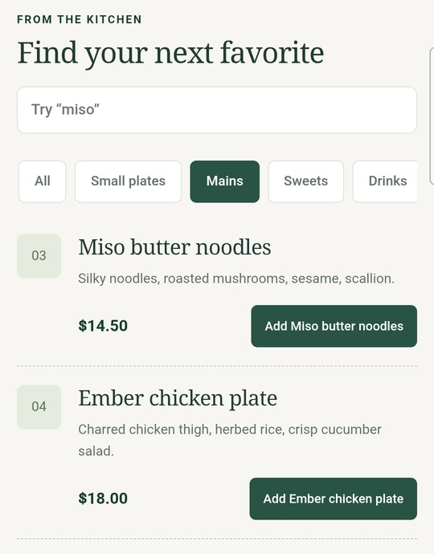
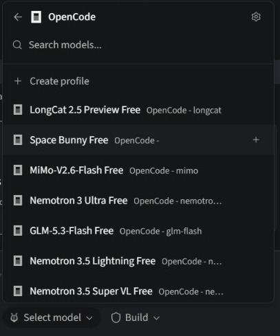
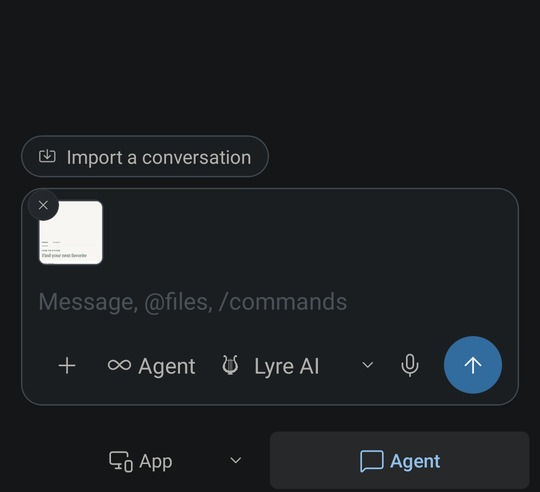
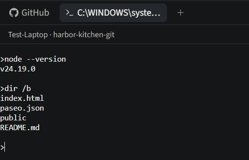

# Lyre features

[Download Lyre](https://github.com/LyreStudio/lyre-releases/releases/latest) · [Get started](https://lyrestudio.net/docs/quickstart.html) · [Team guide](TEAMWORK.md)

Build with coding agents, try the running app, and continue from a paired device. Your computer runs the projects and agents; connected clients let you follow and control the work it shares with you.

## Live app previews

Keep the running app beside your conversation. Ask for a change, review the result,
and try it immediately. Agents and previews run independently.

## Continue from another device

Open the same work from a paired phone, tablet, or computer. Send a follow-up,
review a response, and interact with your app while the host keeps working.

  <a href="assets/features/02-any-device.gif"><picture><source media="(prefers-reduced-motion: reduce)" srcset="assets/features/02-any-device.jpg"><source srcset="assets/features/02-any-device.gif" type="image/gif"></picture></a>
   Samsung test phone connected to Test Laptop, October 20 (debug 0.1.8). Menu filtering in an open preview.

## Your choice of coding agent

Use Claude Code, Codex, GitHub Copilot, OpenCode, or Pi, with the models and accounts
your chosen provider supports. Choose a task mode for making a change, planning,
debugging, or asking a question.

Task modes include Agent, Plan, Debug, Ask, Multitask, and Orchestrate. Queue follow-ups, dictate, and attach files or screenshots through the existing composer. Provider support varies.

  <a href="assets/features/03-agent-choice.gif"><picture><source media="(prefers-reduced-motion: reduce)" srcset="assets/features/03-agent-choice.jpg"><source srcset="assets/features/03-agent-choice.gif" type="image/gif"></picture></a>
   Earlier Lyre 0.1.7 recording on Test Laptop, October 17. Model availability varies.

## Subagents for independent tasks

Delegate independent parts of a task to helper agents. Follow the children started
by the current conversation, open their conversations, and review their results.

## Separate Git worktrees

Give independent work its own checkout and branch. Switch between worktrees to
follow each change and inspect its result.

## Review and commit changes

Read changed files and their actual diffs, stage the files you want, and commit
from the workspace. Keep advanced Git operations within reach through Git tools.

Use built-in terminals to run your project’s checks, and keep pull-request and advanced Git operations within their existing tools.

## Visual feedback for your agent

Attach a screenshot of the running app to show what needs attention. Supported
desktop previews also let you pick an element and include its description in a
targeted request.

  <a href="assets/features/07-visual-feedback.gif"><picture><source media="(prefers-reduced-motion: reduce)" srcset="assets/features/07-visual-feedback.jpg"><source srcset="assets/features/07-visual-feedback.gif" type="image/gif"></picture></a>
   Samsung test phone, October 20 (debug 0.1.8). A preview screenshot attached to an unsent draft.

## Share an app with testers

Invite someone to try a specific app through a link or QR code. App-only access
keeps source files, agent conversations, terminals, and computer settings private.
Manage and revoke access from the existing sharing controls.

Invitations use a single-use link or QR code. Public service links are a separate opt-in feature requiring the host’s grant and an access token. Availability depends on the client and plan.

## Built-in remote desktop

View and control a connected computer's desktop from Lyre. Open the tools you need
through a session with explicit desktop access and the host's platform permissions.

A normal supported install needs no Docker, RDP server, gateway, or SDK for native desktop access. Whole-desktop support is early and depends on platform, permissions, and installed build; pairing alone does not grant desktop access.

## Terminals and CLI profiles

Open a terminal for your workspace or select a configured CLI profile. Run commands
alongside the conversation and preview, with process controls in the workspace.

  <a href="assets/features/10-terminals.gif"><picture><source media="(prefers-reduced-motion: reduce)" srcset="assets/features/10-terminals.jpg"><source srcset="assets/features/10-terminals.gif" type="image/gif"></picture></a>
   Test Laptop, October 20, using the installed test build. Real commands in a disposable demo workspace.

## Local models and routing

Connect supported local model servers such as Ollama, LM Studio, or llama.cpp.
Choose available models and manage provider routes and usage in Full interface.
Model support depends on the agent and your hardware.

Cloud sources retain named, host-stored key profiles and provider account setup. No model weights are bundled. Full interface exposes model routes and usage; local inference depends on hardware and agent support.

## Agent work across computers

Prepare assignments for connected computers, choose their workspaces and models,
and review the plan before starting. Follow the resulting agent conversations
through Lyre's existing orchestration controls.

Owners retain host management. Developer access applies to selected projects, and trusted developer commands execute with the host account’s permissions. Shared conversations and device-labelled pending requests help teammates follow the same work; shared visibility does not assign file ownership. [Team guide](TEAMWORK.md).

## Schedules, activity, and notifications

Schedule recurring agent tasks while the host stays running. Use Activity to find
work that needs input, is ready to review, or is still underway, and configure
notifications for your device.

## Review before publishing

Open Publish from the workspace, choose a supported destination, and review the
project, computer, source, and missing setup before an explicit release action.
Web, local, and mobile destinations retain their platform and account requirements.

## More in Lyre

- **Simplified and Full:** choose the presentation that suits you while keeping selected work, drafts, and running tasks.
- **Library:** find recent work across computers, group projects, and connect supported sessions started in a terminal.
- **Marketplace and plugins:** browse starters and templates, manage trusted executable plugins, and use supported optional extensions. Community catalog listings do not imply executable installation support.

Capabilities depend on the installed build, connection role, platform, provider, plan, and configured services. The host must stay awake and connected for remote work. Clips identify their recording context; they do not certify every platform or release.

[Installation](INSTALL.md) · [Mobile availability](https://lyrestudio.net/docs/release-status.html#ios) · [Plans](https://lyrestudio.net/#pricing) · [Release notes](https://github.com/LyreStudio/lyre-releases/releases) · [Support](https://lyrestudio.net/docs/index.html)
