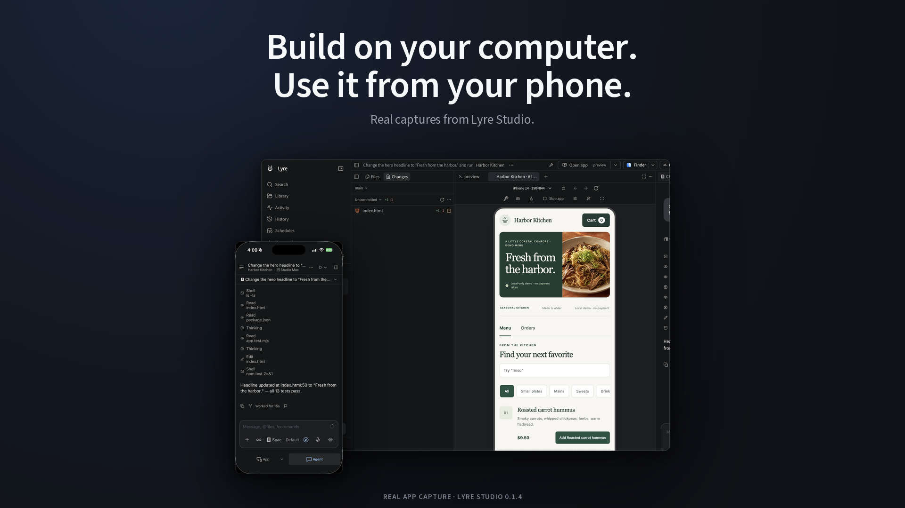
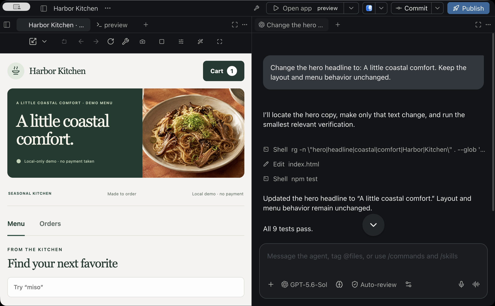
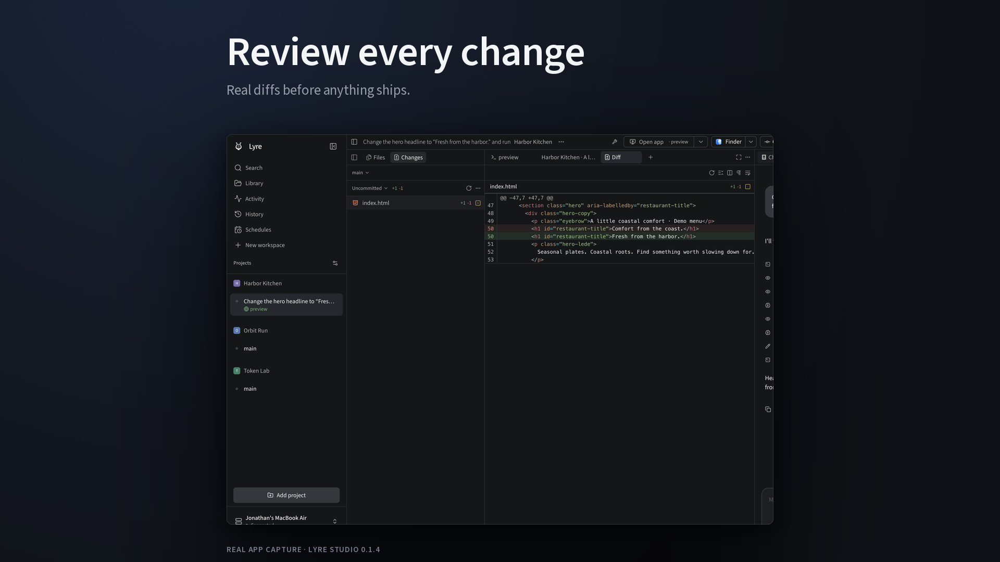
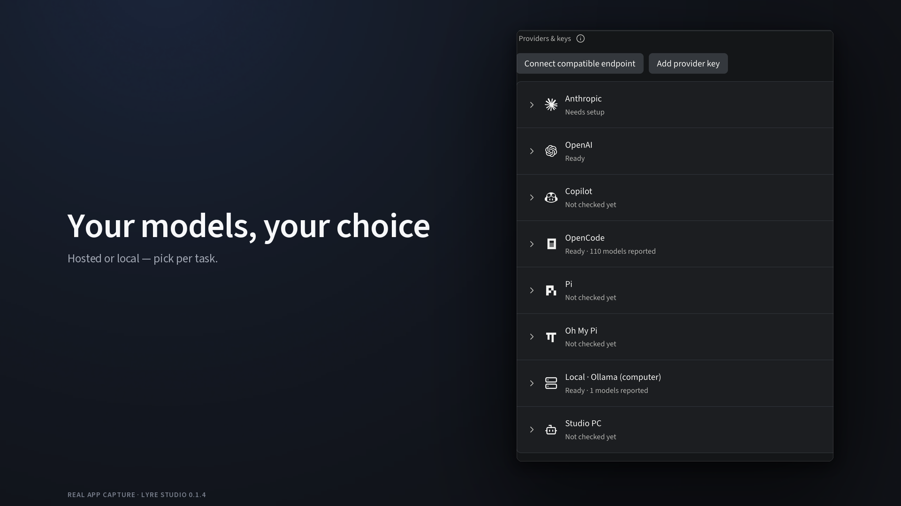
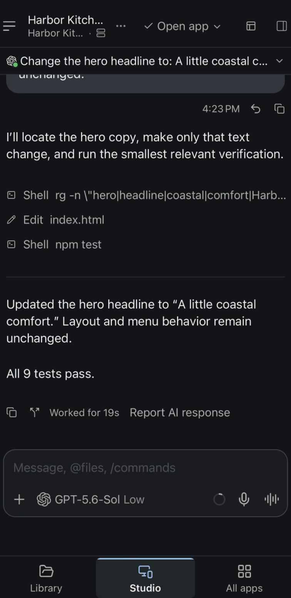
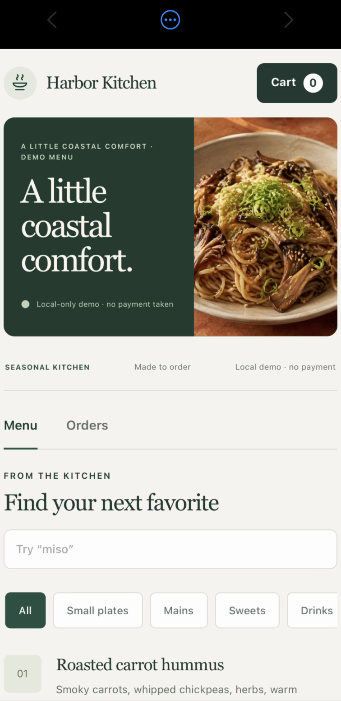

<p align="center">
  <a href="https://lyrestudio.net"></a>
</p>

<h1 align="center">Lyre Studio</h1>

<p align="center"><strong>Build locally. Take it with you.</strong></p>

<p align="center">Coding agents, your models, and your running app, in one workspace on your computer.<br>Drive it from your phone, tablet, or another computer.</p>

<p align="center">
  <a href="https://github.com/LyreStudio/lyre-releases/releases/latest"><strong>Download Lyre Studio →</strong></a> ·
  <a href="https://lyrestudio.net/docs/quickstart.html">Get started</a> ·
  <a href="TEAMWORK.md">Team guide</a> ·
  <a href="https://lyrestudio.net">Website</a> ·
  <a href="https://discord.gg/eGjaBGJgp">Discord</a>
</p>

<p align="center">
  <a href="https://github.com/LyreStudio/lyre-releases/stargazers">
    
  </a>
  <a href="https://github.com/LyreStudio/lyre-releases/releases/latest">
    
  </a>
  <a href="https://x.com/BakhitJonathan">
    
  </a>
  <a href="https://discord.gg/eGjaBGJgp">
    
  </a>
  <a href="https://www.linkedin.com/in/jonathanbakhit/">
    
  </a><br>
  <sub>macOS · Windows · Linux · Early access</sub>
</p>

<p align="center">
  
</p>

## Features at a glance

<table width="100%">
<tr>
<td width="50%" valign="middle">
<h3><a href="FEATURES.md#your-choice-of-coding-agent">Choose your coding agent</a></h3>
<p>Pick the agent and model you want for the task.</p>
<a href="FEATURES.md#your-choice-of-coding-agent">Details &rarr;</a>
</td>
<td width="50%" align="center">
<a href="assets/features/03-agent-choice.gif"><picture><source media="(prefers-reduced-motion: reduce)" srcset="assets/features/03-agent-choice.jpg"><source srcset="assets/features/03-agent-choice.gif" type="image/gif"></picture></a>
</td>
</tr>
<tr>
<td width="50%" valign="middle">
<h3><a href="FEATURES.md#continue-from-another-device">Continue from your phone</a></h3>
<p>Open and interact with an app running on your computer.</p>
<a href="FEATURES.md#continue-from-another-device">Details &rarr;</a>
</td>
<td width="50%" align="center">
<a href="assets/features/02-any-device.gif"><picture><source media="(prefers-reduced-motion: reduce)" srcset="assets/features/02-any-device.jpg"><source srcset="assets/features/02-any-device.gif" type="image/gif"></picture></a>
</td>
</tr>
<tr>
<td width="50%" valign="middle">
<h3><a href="FEATURES.md#visual-feedback-for-your-agent">Show your agent what to change</a></h3>
<p>Attach a preview screenshot to your next message.</p>
<a href="FEATURES.md#visual-feedback-for-your-agent">Details &rarr;</a>
</td>
<td width="50%" align="center">
<a href="assets/features/07-visual-feedback.gif"><picture><source media="(prefers-reduced-motion: reduce)" srcset="assets/features/07-visual-feedback.jpg"><source srcset="assets/features/07-visual-feedback.gif" type="image/gif"></picture></a>
</td>
</tr>
<tr>
<td width="50%" valign="middle">
<h3><a href="FEATURES.md#terminals-and-cli-profiles">Run project commands</a></h3>
<p>Use a terminal alongside your conversation and app.</p>
<a href="FEATURES.md#terminals-and-cli-profiles">Details &rarr;</a>
</td>
<td width="50%" align="center">
<a href="assets/features/10-terminals.gif"><picture><source media="(prefers-reduced-motion: reduce)" srcset="assets/features/10-terminals.jpg"><source srcset="assets/features/10-terminals.gif" type="image/gif"></picture></a>
</td>
</tr>
</table>

**Also in Lyre:** [Live app previews](FEATURES.md#live-app-previews) · [Subagents for independent tasks](FEATURES.md#subagents-for-independent-tasks) · [Separate Git worktrees](FEATURES.md#separate-git-worktrees) · [Review and commit changes](FEATURES.md#review-and-commit-changes) · [Share an app with testers](FEATURES.md#share-an-app-with-testers) · [Built-in remote desktop](FEATURES.md#built-in-remote-desktop) · [Local models and routing](FEATURES.md#local-models-and-routing) · [Agent work across computers](FEATURES.md#agent-work-across-computers) · [Schedules, activity, and notifications](FEATURES.md#schedules-activity-and-notifications) · [Review before publishing](FEATURES.md#review-before-publishing).

[**Explore all 14 features and full-size demos →**](FEATURES.md)


## Get Lyre Studio

[**Download the latest release →**](https://github.com/LyreStudio/lyre-releases/releases/latest)

| Your computer                    | Recommended download                              | Availability         |
| -------------------------------- | ------------------------------------------------- | -------------------- |
| **macOS · Apple silicon**        | **.dmg**: open it, then drag Lyre to Applications | Signed and notarized |
| **Windows · Intel / AMD 64-bit** | **Setup .exe** installer                          | Available · unsigned |
| **Linux · Intel / AMD 64-bit**   | **AppImage**, or **.deb / .rpm**                  | Available · unsigned |

No Intel Mac package is currently published. iOS and Android clients have separate
testing and distribution channels; check [mobile availability](https://lyrestudio.net/docs/release-status.html#ios).

[Installation and updates](INSTALL.md) · [Release notes](https://github.com/LyreStudio/lyre-releases/releases) ·
[Compare plans](https://lyrestudio.net/#pricing)

### Use Lyre from your terminal

The npm package installs the **CLI and host daemon** for managing projects,
workspaces and coding agents. Download the desktop app above for the graphical
workspace. The host runs your projects and agents; connected clients let you
follow and control that work.

Requires **Node.js 22.12 or newer**, with npm. The initial npm release is verified
on **Windows x64 with Node.js 24**; installed macOS/Linux qualification is pending.

```sh
npm install --global @lyrestudio/cli@beta
lyre --version
lyre --help
```

If you already use Lyre Studio desktop, try `lyre status` to check the selected
host. To run a standalone host from npm, start its background daemon:

```sh
lyre daemon start
lyre status
lyre provider ls
```

Install and sign into a supported coding provider before starting an agent.
From an existing project folder, this example uses Codex to explain the project:

```sh
lyre project create .
lyre run --provider codex --cwd . --task-mode ask "Explain this project without changing files."
lyre ls
```

Choose an available provider shown by `lyre provider ls`; replace `codex` if you
use another. To follow a task, use `lyre logs AGENT_ID --follow`, replacing
`AGENT_ID` with its ID from `lyre ls`. Use `lyre pair` to approve a trusted
client and obtain connection instructions; review the requested owner access.

The npm CLI is **0.11.0-beta.3**, accompanying desktop **0.1.6**. The `lyre`,
`lyre-foundation` and `paseo` commands are aliases for the same CLI. npm installs
the required runtime packages automatically.

[npm package](https://www.npmjs.com/package/@lyrestudio/cli) ·
[Full CLI walkthrough, updates and troubleshooting](INSTALL.md#command-line-interface)

[Website CLI quickstart](https://www.lyrestudio.net/docs/cli-quickstart.html) ·
[Command reference](https://www.lyrestudio.net/docs/cli.html) ·
[Lyre CLI workflows](https://www.lyrestudio.net/docs/cli-workflows.html)

### Lyre features you can use from the CLI

The CLI brings more of Lyre's development workflow to your terminal:

| Feature                    | How to use it                                                                                                                                                                                                                              |
| -------------------------- | ------------------------------------------------------------------------------------------------------------------------------------------------------------------------------------------------------------------------------------------ |
| **Task modes**             | Use `lyre run --task-mode plan` to plan a change, `debug` to investigate a failure, `ask` for questions, or `multitask` for useful delegation when the provider has the tools. Use `agent` to carry out a change.                          |
| **Separate Git worktrees** | Add `--new-workspace worktree --new-branch fix-login` to a run to work in a separate checkout. Reuse it later with `--workspace WORKSPACE_ID`.                                                                                             |
| **Screenshot context**     | Send an image to an existing agent with `lyre send AGENT_ID --image screenshot.png "Explain this screenshot."`, then review the transfer prompt. The selected provider must support images.                                                |
| **App preview setup**      | Inspect your project with `lyre preview inspect . --json`, review a configuration with `lyre preview plan . --port 5173 --json`, and control workspace services with `lyre script start` / `stop`. Agents and services stop independently. |
| **Recurring agent tasks**  | Use `lyre schedule create` with a cadence, provider and task mode; inspect run history and pause or resume the schedule. The host must stay running.                                                                                       |
| **Permission review**      | Use `lyre permit ls` to see pending requests, then approve or deny a specific request after reviewing it.                                                                                                                                  |
| **Host plugins**           | Use `lyre plugin ls`, statically check a plugin with `lyre plugin check`, and review available updates with `lyre plugin update --all --check`. Install only code you trust.                                                               |

Task modes guide the request; they do not change permissions. Preview viewing,
app-sharing invitations and whole-desktop control use the supported Lyre clients.

[**See complete CLI examples for these features →**](INSTALL.md#lyre-features-from-the-terminal)

## Major features

[**Explore the feature showcase →**](FEATURES.md)

### Build together, with clear project access

Work with teammates on the same project from connected computers and mobile
clients. See the work already underway, divide the next steps, and validate the
result together.

1. **Choose who can do what.** Grant Developer access to selected projects, keep
   host management with Owners, and give testers access only to the apps you share.
2. **Follow the same work.** Open accessible agent conversations in the project's
   workspace to read requests and responses. Shared pending requests carry device
   labels, helping you spot a task that is already queued.
3. **Bring feedback into the conversation.** Ask about an agent's result or send a
   correction in the same chat. Use inline code review comments where your
   connection supports them, then send the review to the agent.
4. **Divide tasks and edits.** Use separate conversations for independent jobs and
   Git worktrees for separate checkouts. Supporting builds can plan and dispatch
   agent work across connected computers with their available models.
5. **Check the result together.** Review the changes and tests, integrate the
   branches, and let teammates try the running app on their devices.

Shared visibility helps people avoid duplicate work; the team still agrees on
ownership and reviews overlapping changes. Developer commands execute with the
host account's permissions, so project grants are for trusted collaborators.
Available controls depend on the connection role and installed versions.

[**Set up your team and follow a complete workflow →**](TEAMWORK.md)

### Every agent, the right mode

Bring the coding agent you already use: **Claude Code, Codex, GitHub Copilot, OpenCode,
and Pi** run side by side, organized by project. Pick a **task mode** in the composer:

| Mode            | Use it to                                                    |
| --------------- | ------------------------------------------------------------ |
| **Agent**       | make the change end to end                                   |
| **Plan**        | agree on an approach before any edits                        |
| **Debug**       | investigate a failure step by step                           |
| **Ask**         | get an answer without touching files                         |
| **Multitask**   | hand parts of a task to helper agents                        |
| **Orchestrate** | coordinate larger work across helpers and review it together |

Run independent work in separate **Git worktrees**, queue follow-up messages, dictate
by voice, and attach screenshots or files. Provider accounts, installation, and model
access vary by provider.

### Your app, live, beside the chat

Start your project's preview with **Open app** and try it next to the conversation,
or open it on its own. Agents and previews have independent lifecycles: stopping one
doesn't stop the other. Attach a preview screenshot to the next message when
something looks off.

<p align="center">
  
</p>

### Review before you ship

Inspect every changed file in the **Changes** view, read the actual diff, and run
your project's tests in built-in **terminals**. Commit, open a pull request, or
keep iterating. A running app is something you can try; your checks decide whether
it's ready.

<p align="center">
  
</p>

### Your models, your way

- **Cloud providers:** connect Anthropic, OpenAI, and other supported sources with
  named, host-stored key profiles or managed setup.
- **Local models:** add **Ollama, LM Studio, llama.cpp**, or a compatible server and
  use its models like any other. No model weights are bundled.
- **Routing:** browse a shared model catalog, set routes, and see a live route map
  and usage report.

Local inference depends on your hardware and the chosen agent's model support.

<p align="center">
  
</p>

### Continue on any device

Your computer runs the projects and agents; **paired clients** pick up the same work.
Follow an agent, review its changes, try a website by touch, or play the browser
game you're building from your phone. Connect directly on your network or through an
**end-to-end encrypted relay**. The host must stay awake and connected.

<p align="center">
  &nbsp;
  &nbsp;
  
</p>

### Your whole desktop, built in

Open a connected computer's **entire screen** from Lyre and take control, for the
tools that don't live in a browser: a game engine, a design app, a build monitor.
Remote desktop is native to Lyre, so a normal install needs **no Docker, RDP server,
gateway, or SDK**. Each session asks for consent, and pairing alone never grants
desktop access. _Early: cross-device qualification is ongoing, and support depends on
platform, permissions, and build._

### Share the app, not the code

Invite a tester with a **single-use link or QR code**. **App-only access** lets them
use the app you shared, while source files, agent sessions, terminals, and computer
settings stay private. Revoke access at any time. For a public URL, **opt-in public
service links** require both your grant and an access token. Client support varies by
platform and plan; see [plans](https://lyrestudio.net/#pricing).

### It keeps working while you're away

**Activity** groups work that needs your input, is ready to review, or is still
running. **Schedules** run recurring agent tasks, and **notifications** tell you when
work finishes or a preview becomes ready.

## What's supported

|                    | Supported today                                                                            |
| ------------------ | ------------------------------------------------------------------------------------------ |
| **Host computers** | macOS (Apple silicon), Windows 64-bit, Linux 64-bit                                        |
| **Clients**        | Lyre Studio desktop app; iOS and Android apps in testing                                   |
| **Coding agents**  | Claude Code, Codex, GitHub Copilot, OpenCode, Pi                                           |
| **Model sources**  | Provider accounts and API keys; Ollama, LM Studio, llama.cpp, and compatible local servers |
| **Connections**    | Direct on your local network or VPN, or through an end-to-end encrypted relay              |
| **Previews**       | Web apps and browser games served by your project, on the desktop and on paired clients    |
| **Remote desktop** | Built-in whole-desktop viewing and control (early)                                         |
| **Accounts**       | Local projects and local-network use need no Lyre cloud account                            |

<details>
<summary><strong>More in the workspace: publishing, marketplace, plugins, and customization</strong></summary>

- **Publish and deploy:** prepare mobile releases with integrated Fastlane tools, your
  signing setup, platform tooling, and store accounts. Setting up isn't the same as a
  completed store submission.
- **Marketplace and plugins:** browse project starters and templates, and manage
  executable host plugins. Community Extensions are a discovery catalog; extension
  installation is unavailable.
- **Simplified or Full:** choose a simpler project → chat → preview flow or a dense
  development workspace. Switching keeps your selected work and drafts.
- **Library and projects:** find recent work across computers, group projects, and
  import sessions started in a terminal.

</details>

## Your first development loop

1. **Open a project.** Choose the folder on the computer that will run it.
2. **Connect an agent or model.** Follow its installation and account setup.
3. **Make a change and try it.** Ask for a change, press **Open app**, and review the
   agent's work.
4. **Connect another device.** Use **Pair Device** with a supported client and
   explicitly grant the access it needs.

[First-project guide](https://lyrestudio.net/docs/quickstart.html) ·
[Existing projects](https://lyrestudio.net/docs/projects.html) ·
[App recipes](https://lyrestudio.net/docs/app-recipes.html)

Lyre is in early access. Capabilities depend on the installed build, provider,
platform, and configured services. [Release notes](https://github.com/LyreStudio/lyre-releases/releases)
list version-specific changes and known limitations.

## Help shape Lyre

[Report a bug](https://github.com/LyreStudio/lyre-releases/issues/new?template=bug_report.yml) ·
[Request a feature](https://github.com/LyreStudio/lyre-releases/issues/new?template=feature_request.yml) ·
[Join Discord](https://discord.gg/eGjaBGJgp) ·
[Read the docs](https://lyrestudio.net/docs/index.html)

For security issues, use [private reporting](SECURITY.md).

---

This is Lyre Studio's official repository for **downloads, release notes, and
feedback**. Application source is maintained privately. **Lyre Studio is proprietary**;
see the [license notice](LICENSE), [EULA](https://lyrestudio.net/legal/eula.txt), and
[third-party licenses](https://lyrestudio.net/legal/third-party-licenses.html).
The application foundation derives from [Paseo](https://github.com/getpaseo/paseo),
with its Apache-2.0 license and notices preserved.

<p align="center"><sub>© 2026 Jonathan Bakhit · Lyre Studio · <a href="https://lyrestudio.net/privacy.html">Privacy</a></sub></p>
